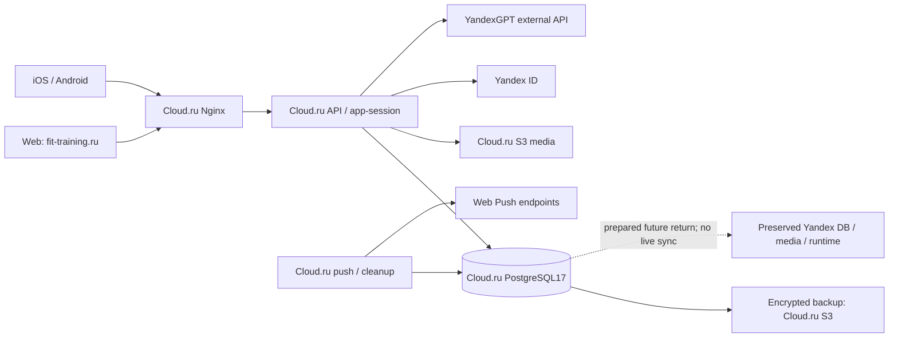

# Fit: аудит Cloud.ru и готовности возврата — 16.10.2026

## Решение и границы доказательств

Cloud.ru — текущий активный контур. Yandex Cloud — цель планового возврата
после восстановления и отдельной приёмки. Возврат пока **не готов к исполнению**:
нет проверенного общего запрета записи и процедуры согласования разошедшихся
историй. Остановка записи ≤2 часов и отсутствие потери подтверждённых записей —
критерии будущего перехода, а не уже доказанные свойства.

База аудита: main `d06f01e6cbee68b5d79e1fc5ec76668f8b025da0`.
[Утверждённый план](CLOUD_RETURN_AUDIT_PLAN_20261016.md) сохранён дословно.
[Инструкция возврата](CLOUD_RETURN_RUNBOOK_20261016.md) описывает будущую
операцию и обязательные блокирующие условия. В ходе аудита нет deployment,
production-записей, переноса реальных данных, включения workers/уведомлений или
изменений IAM/DNS. Чужие untracked-файлы исходного checkout не использованы.
Tracker/YAFIT connector в сессии отсутствует; внешний тикет и копия плана в нём
не созданы. Локальные ID очереди ниже служат ссылками до переноса в Tracker.

Статусы: **проверено здесь** — воспроизводимая проверка этого аудита;
**историческое доказательство** — существующий run с указанным SHA/датой;
**код/конфигурация** — возможность обнаружена, работа сервиса не доказана;
**не проверено** — данных недостаточно; **блокирует возврат** — нельзя открывать
запись в целевом облаке до закрытия пункта.

## Карта системы и доступов

Владельцы ниже — необходимые технические роли, а не подтверждённые назначения
людей. Персональный ответственный и резервный оператор должны быть назначены
в задаче A10. Названия секретов — только ссылки на закрытые хранилища; значения,
пользовательские идентификаторы, object keys и содержимое данных не собирались.

| Сервис | Активное размещение и зависимости | Доступ / технический владелец | Обновление и откат / доказательство |
| --- | --- | --- | --- |
| DNS и TLS | Cloud.ru DNS; root/www/api ведут в Cloud.ru Nginx; сертификаты Let's Encrypt | DNS-zone editor отдельно от TLS/VM operator | Ingress workflow и certbot; восстановление записей не восстанавливает данные. Публично DNS3/3, TLS87дней; renewal — исторический run38781593349 |
| Сайт | Cloud.ru VM, Nginx, versioned frontend candidates; web API `https://fit-training.ru/api` | Release operator, GitHub Actions environment; runner OS privileges | `prepare-cloudru-frontend.yml`, exact-main CI, candidate/manifest и guarded promotion. Полные публичные bytes сверены с опубликованным manifest |
| Native clients | Установленные iOS/Android bundles; новые используют `https://api.fit-training.ru` | Mobile release operator, signing вне репозитория | Build/rebuild отдельно; DNS не меняет встроенный технический origin старой версии. Устройства в аудите не проверены |
| API / app-session | Cloud.ru VM, Podman, loopback API за Nginx, Cloud.ru PostgreSQL/S3 | Runtime `fit_api`; deployment через trusted runner. Owner credentials runtime не получает | `release-cloudru-api-stage.yml`: pending migrations, candidate, promotion, rollback image. Публичный health сообщает d06f01e6; build marker отдельно от RUNNING_SHA |
| PostgreSQL17 | Cloud.ru managed PostgreSQL, actor transactions/RLS, numbered migration history | `fit_api` для runtime; `fit_owner` только maintenance/migration; отдельные analytics grants | Forward migrations с lock/backup. Rollback API не отменяет DDL. Target валидируется кодом; прямой production DB readback в этом аудите не выполнялся |
| Media | Cloud.ru S3, private object transport и подписанные URL; legacy adapters ещё существуют | Runtime object read/write; inventory/ACL и backup privileges отдельно | Односторонний migration workflow; новое обратное копирование отсутствует. Media check последнего backup упал отдельно; это не доказательство отказа upload/read пользователя |
| Вход | Внешний Yandex ID; OAuth callback и app-session обслуживаются Cloud.ru API/БД | OAuth application operator; runtime OAuth secret в закрытом env | Стабильные callback/deep link/CORS контракты. Настоящий вход/привязки здесь не проверены; GET защищённых маршрутов без сессии возвращает401 |
| ИИ | Оркестрация в Cloud.ru API, внешний YandexGPT; credential bootstrap зависит от Yandex IAM/Lockbox/OIDC | Scoped model credential; release operator отдельно от model IAM | `configure-cloudru-ai.yml`, candidate/synthetic model check/rollback; prompt не меняется. Наличие кода и прежний smoke не доказывают текущую authenticated генерацию |
| SpeechKit | Предусмотрен Cloud.ru relay `/stt`, upstream `stt.api.cloud.yandex.net`; старый relay VM в Yandex — legacy | Отдельный STT key/folder; relay без DB/media/model credentials | По последнему решению владельца OFF; failed inspect38916683079 не доказывает отказ нового включённого сервиса. Не активировать в аудите |
| Push / cleanup | Cloud.ru systemd worker/timer раз в минуту, outbox в PostgreSQL, внешние Web Push endpoints | `fit_api` + прежняя VAPID identity; background operator | `configure-cloudru-background.yml`; cutoff/receipts сохраняются; старый Yandex timer исторически PAUSED. Ops38915615795 successful; доставка на устройство не проверена |
| Feedback / recovery mail | Feedback Telegram/Tracker OFF по решению владельца. Recovery mail — отдельный ручной legacy workflow, внешний SMTP | Ограниченные campaign/SMTP credentials, отдельное право отправки | Не часть обычного release; аудит не запускает отправки и не собирает аудиторию |
| CI и runner | GitHub hosted checks; Cloud.ru self-hosted runner на той же VM, что runtime | Repository write / Actions read; runner service + scoped sudo для release | VM lock сериализует mutation workflows; retention ежедневно05:17МСК. Отказ VM одновременно затрагивает runtime и управление выпуском |
| Backup | Зашифрованный DB archive в отдельном private Cloud.ru S3 bucket, вне VM, но в том же облаке | Отдельная backup S3 pair + DB owner + AES key; runtime без backup pair | Ежедневно05:35МСК; readback/decrypt/изолированный restore. Retention объектов не задан кодом; key recovery и межоблачная независимость требуют A03 |
| Сохранённый Yandex | Прежние DB/storage/serverless/infra state; remote autodeploy выключен | Старые scoped identities; для возврата нужна новая проверка фактических grants | Это сохранённая история и кандидат для восстановления, не актуальная синхронная копия. Supabase — frozen local/legacy/rollback; Vercel — только redirect |

Источники: `infra/cloudru`, Cloud.ru workflows, `scripts/check-cloudru-api-env.mjs`,
`configure-cloudru-ai.mjs`, `configure-cloudru-background.mjs`,
`services/api/src/cloudru-backup.ts`, `cloudru-media-health.ts`,
`object-storage-media.ts`, `cloud-database-transfer.ts` и `OPERATIONS.md`.

## Что действительно проверено

| Сценарий | Локальное доказательство | CI / существующие проверки | Production |
| --- | --- | --- | --- |
| Загрузка сайта, web/native API boundary | Hosting/unit checks входят в `npm run check` | FE38923791610, API38923791432 на d06f01e6 success | В этом аудите DNS3/3, HTTP/TLS8/8; JS12/CSS1/fonts6 + index =20/20 совпали по размеру и SHA256; API release d06f01e6 |
| Вход, роли, восстановление сессии | Целевые browser fixtures и API auth tests; результат в журнале проверок ниже | На main CI38923126575 browser lane **skipped**; зелёный aggregate не заменяет browser run | Только401 boundary; OAuth callback, регистрация и реальные роли не проверены |
| Приглашение и подключение клиента | `app.test.ts`, actor/RLS integration: ownership, claim/revoke, tenant isolation | yandex-database job main passed; отдельные тестовые identities не равны реальным аккаунтам | Не проверено |
| Тренировки: чтение, план, Live, сохранение | Actor/RLS integration: lifecycle, retry/version/ownership; API/unit coverage | API/main checks passed; здесь новая production mutation не выполнялась | Authenticated read/write/reload не проверены |
| Media | `object-storage-media`, chat/profile media contracts с mock transport | Последний backup38867496640: DB restore success, media failure | Upload/sign/read/delete пользователя и свежая полнота inventory не проверены |
| Питание | Actor/RLS + browser fixtures: native cohort, дневник, consent/read-only | Схема numbered migrations; frontend pilot не равен server authorization | Реальная доступность пилота и сохранение не проверены |
| Учёт оплат | Actor/RLS trainer finance + unit/component contracts | Покрывает учёт полученных сумм/долга; не подтверждает банковский эквайринг | Реальные операции не выполнялись; внешний эквайринг не заявляется |
| ИИ и голос | API/unit с mocks; model calls и STT не запускались | Исторический server smoke отдельно; voice OFF | Текущая authenticated генерация/диктовка не проверены |
| Push / session cleanup | Existing unit/DB tests: leases, finalize, idempotency, opt-out и несколько устройств | Ops38915615795 success; исторический worker readback | Новая отправка не выполнялась; получение пользователем не подтверждено |
| Восстановление БД | Изолированная synthetic rehearsal; существующие DB integration ниже | Backup38867496640: upload/readback/decrypt и restore success, media failure; прежний38777631050 аналогично | Это реальный production backup drill в существующем run, **не запуск этого аудита** |

### Свежесть и границы CI

Read-only repository variables на16.10: CLOUDRU_STAGE/API/FRONTEND autodeploy=true;
YC_FRONTEND и YC_STAGE_TERRAFORM autodeploy=false. Они не изменялись.
Main CI38923126575 successful: app-quality, app-tests, API, yandex-database,
frontend-infrastructure. Browser/legacy database lanes skipped по scope.
Merge даже документации запускает main CI и может выпустить Cloud.ru:
этот аудит передаётся PR, без merge/deployment.

Исторические ссылки:
[main CI](https://github.com/podkolzinpd/fit/actions/runs/38923126575),
[API release](https://github.com/podkolzinpd/fit/actions/runs/38923791432),
[frontend](https://github.com/podkolzinpd/fit/actions/runs/38923791610),
[backup + media failure](https://github.com/podkolzinpd/fit/actions/runs/38867496640),
[ops](https://github.com/podkolzinpd/fit/actions/runs/38915615795).
Raw logs, дампы и приватные artifacts не публикуются.

## Риски возврата и оставшиеся зависимости

1. **Две независимые истории.** Существующий аудит38638075365 обнаружил
   независимые изменения обеих БД. Это исторический сигнал, а не текущий diff.
   Нельзя выбрать Cloud.ru «истиной» и затереть старый Yandex без классификации
   уникальных записей/конфликтов. Нельзя применять last-write-wins по timestamp.
2. **Нет доказанного общего write fence.** Найденный source-cutover-write-gate
   относится к legacy Supabase. Maintenance UI и DNS не закрывают API, worker,
   старые native bundles, прямые endpoints и операции, уже начавшиеся до freeze.
3. **Обратный перенос не реализован.** `cloudru-sql-transfer-cli` и
   `cloud-database-transfer` проверяют пустой target, ориентированы на прежнее
   направление и не являются merge engine или готовым reverse workflow.
4. **Media и БД должны соответствовать одному checkpoint.** Полный object
   checksum, новые/изменённые/удалённые объекты, версии, metadata и signed URLs
   обязательны. S3 ETag не использовать как универсальный content SHA256.
   Существующий media-health читает объекты, но не создаёт независимую копию.
5. **Cloud.ru не полностью независим от Yandex.** Внешний model API остаётся
   зависимостью ИИ; SpeechKit при включении — голоса; Yandex ID — входа.
   Обновление внешних credentials через Yandex IAM/Lockbox может быть недоступно
   отдельно от действующего runtime key. Разделить отказы, проверить degraded
   states; не обещать доступность без этих сервисов.
6. **Восстановление БД вне VM уже доказано, восстановление вне облака — нет.**
   Backup и runtime используют Cloud.ru; недоступность provider/account может
   затронуть оба. Управление release/backup/ops зависит от одной runner VM.
7. **TLS PostgreSQL `require` шифрует, но не проверяет CA/hostname.** Это
   существующий явно описанный контракт, не новая регрессия; отдельное усиление
   до проверяемого trust chain, без ослабления TLS ради возврата.

## Наблюдение: существующее и пробелы

| Сигнал | Реализованный контроль | Что ещё проверить/добавить |
| --- | --- | --- |
| DNS/web/API/TLS | Hosted workflow каждые15мин; certificate margin14дней | Контакт оператора, подтверждённый alert/recovery delivery и работа при отказе GitHub |
| Полные frontend bytes | Manifest/candidate checks при release; здесь публичный SHA25620/20 | Периодический public content-integrity контроль, не только /auth200 |
| API errors/latency | Safe request diagnostics и pool-window агрегаты в коде | Central collection, пороги по error ratio/p95, baseline и retention не доказаны |
| PostgreSQL | Readiness и pool diagnostics | Connections/locks/storage/provider availability alerts, без SQL/PII в отчётах |
| Disk/worker/queue | Hourly ops, disk≥2GiB, pending/overdue/stale/terminal; daily bounded retention | Ежечасный workflow не гарантирует доставленное оповещение; нужен проверенный маршрут |
| Backup | Daily DB drill; verified marker<48h в ops | Retention, capacity до лимита64MiB, key escrow, media recovery и копия вне Cloud.ru |
| Media | Daily ACL/versioning/inventory gate, сейчас failure | Принимать отдельно от БД; запрет owner на изменение IAM/ACL сохраняется |
| Расходы | Billing readback в аудите недоступен | Отдельные лимиты/alerts для обоих облаков, storage growth, egress и model usage; суммы не выдумывать |

## Очередь исправлений

P0 здесь означает блокер **возврата**, а не доказанную текущую аварию продукта.
Каждая строка — отдельная задача/PR; приоритет не разрешает production mutation.

| ID / приоритет | Задача / владелец / роль | Зависимости | Приёмка |
| --- | --- | --- | --- |
| A01 / P0 | Согласовать истории Cloud.ru/Yandex; data owner | Приватный доступ к согласованным snapshots после восстановления | Full table/key comparison, inserts/updates/deletes классифицированы; конфликты разрешены владельцем домена; обе исходные истории сохранены; ни одна подтверждённая запись не потеряна |
| A02 / P0 | Общий запрет записи и одиночный активный writer; API/DB/ops | Инвентарь всех credentials, endpoints, SECURITY DEFINER и workers | Existing pools/in-flight transactions, auth/session, API, native, signed upload URLs и jobs закрыты; refresh/retry не обходят запрет; завершение pre-freeze операций подтверждено |
| A03 / P1 | Recovery policy и независимая копия; backup operator | Billing/IAM/retention review, без расширения доступа в аудите | Согласованы RPO/RTO, retention/key recovery; restore без основной VM и доступа к runtime cloud; зашифрованная копия читается минимальными правами |
| A04 / P0 | Media return и восстановление; storage operator | A01, existing media ACL constraint | Отдельный приватный target, content SHA256+metadata manifest; копирование/удаления/retry без потерь, ссылочная целостность с БД; owner разрешает необходимый доступ отдельным решением |
| A05 / P0 | Reverse transfer workflow и совместимость Yandex; release/data operator | A01,A02,A04 | Новый target без перезаписи старой БД; roles/extensions/RLS/grants/history и API boot; sessions/callbacks; оба направления локально проверены; нет auto-enable старых timers |
| A06 / P0 | Полная репетиция возврата и тайминг; release operator | A01–A05 | Репрезентативный synthetic объём, реальный API/storage adapters, старый клиент/pool, faults/retry/cancel; freeze≤120мин, abort до открытия записи; после первой записи есть обратный перенос |
| A07 / P1 | Приёмка product journeys; QA/feature owners | Выделенные identities и отдельное разрешение на production-записи | Client/trainer OAuth, invitation, workout reload, media, nutrition/finance, AI и device push; каждый реальный результат отдельно от mocks |
| A08 / P1 | Alert/recovery и бюджет; ops/billing owner | Назначенный получатель и канал | Fault injection в test среде, доставленное alert/recovery, runbook; лимиты расходов/роста backup и запас диска подтверждены |
| A09 / P1 | Общая тестовая среда; infrastructure owner | Отдельная согласованная среда/бюджет | Synthetic-only БД/S3, Yandex-only contracts, auth test path, CI exact-SHA deploy/reset/rollback; без production secrets и Vercel Preview |
| A10 / P1 | Доступы, резервный оператор, локальный onboarding; project owner | Read-only IAM/billing inventory | Назначены ответственный+замена; матрица least privilege и break-glass, чистый Podman launch; восстановление доступа не зависит только от отказавшего облака |
| A11 / P2 | PostgreSQL peer verification; DB operator | Подтверждённые provider CA/hostname | Проверяемая цепочка TLS, отрицательные tests неверного CA/host, совместимость pooler, без отключения проверки |
| A12 / P2 | Выбрать Cloud.ru reserve после возврата; product/ops | Измерения A03,A06 и фактический billing | Согласованы стоимость, RPO/RTO и частота репетиций. Не включать репликацию/автоfailover в этом PR |

Порядок: A01/A02/A04 → A05 → A06 → отдельное решение о возврате.
A03/A07–A10 выполняются как самостоятельные задачи; их незакрытые риски явно
учитываются при release gate. Нет доказанной критичной продуктовой поломки по
публичной проверке; authenticated сценарии остаются неизвестными.

## Сравнение резерва после возврата

| Вариант | Содержание и расходы | RPO/RTO и эксплуатация |
| --- | --- | --- |
| Холодный | Проверенные encrypted backups/мedia copies, versioned artifacts/IaC, сохранённые доступы; нет постоянно готового runtime | Потеря до последней доступной копии; запуск и restore занимают измеренное время. Дешевле по runtime, но rehearsal и storage/egress оплачиваются |
| Тёплый | Готовый runtime, совместимая schema, регулярная доставка DB/media changes; дополнительные compute/storage/traffic/monitoring | Меньше объём финального переноса, но свежесть должна контролироваться. RPO не равен нулю при lag; split-brain предотвращает write fence, не DNS |

Тарифы и фактический bill не получены: денежных оценок нет. Сравнение не является
решением об оплате. Сейчас разрабатывается плановый возврат, а не автоматический
аварийный failover; двухчасовое окно не обещается при потере доступа к источнику.

## Журнал выполненных проверок

- `VITEST_MAX_WORKERS=4 npm run check`: exit0; frontend2703/API1425 passed,
  160 стандартных DB skips, infra318/hosting169/calendar12/media2/iOS permissions5,
  lint/typecheck/coverage/API build/frontend build passed.
- Отдельный Podman PostgreSQL17, loopback55439, tmpfs, отдельный контейнер:
  clean migration chain и actor/RLS/release integration **151/151**,13.05s;
  реальный pg_dump/restore fixture включён. Общие локальные базы не затрагивались.
- Два независимых PostgreSQL17 без сети/портов: **23/23**,8.22s total,
  freeze3.91s на маленькой fixture. Старый target history сохранён отдельно.
  Это не приёмка production SLA; ограничения явно включены в JSON.
- Production build с проверенными Lime fonts2/2, synthetic API fixtures:
  Chromium7/7 + WebKit7/7,25.3s. Оси — два разных browser engines; дополнительной
  theme/user матрицы нет. Сценарии: entry390/430, session reload/error+retry,
  nutrition admission/denial/manual/search failure/direct-route guard.
- Настоящий `/auth`, fresh browser context без входа: Chromium/WebKit2/2,
  HTTP200, primary login1, overflow=false, pageErrors0. WebKit390 screenshot
  просмотрен как диагностический артефакт, не visual regression assertion.
- Публичный manifest d06f01e6:20/20 полных JS/CSS/fonts/index,5343294bytes,
  size+SHA256 matched; DNS3/3, HTTP/TLS8/8 passed.

Безопасные доказательства: [проверки](cloud-return-audit-20261016/checks.json),
[public](cloud-return-audit-20261016/public.json),
[browser](cloud-return-audit-20261016/public-browser.json),
[rehearsal](cloud-return-audit-20261016/rehearsal.json).
JSON содержит только агрегаты, версии и статусы; synthetic fixture не содержит PII.

Первый запуск rehearsal встретил временный Unix socket стадии init PostgreSQL:
readiness исправлена на окончательный loopback TCP listener. Первый browser config
не задал cwd; затем development run прошёл14/14, но дал предупреждения о font
symlinks. Финальная browser-приёмка повторена на production bundle с fonts2/2,
без изменения product code/assertions/timeouts. После проверки скрипта cleanup
успешный JSON публикуется только после удаления своих контейнеров.

Не запускались: обычный `npm run dev`/shared `local:verify`, полная legacy browser/
visual матрица, реальные OAuth/mutations/media/push, iOS/Android builds, billing/IAM
console readback и полный межоблачный переход. Отсутствие schema/UI изменений не
требует новых migrations, generated Supabase types или PRODUCT_WIKI/parity правок.
Реализованный пользовательский контракт не меняется.

## Матрица утверждённого плана

Порядок соответствует исходному плану; фактическое выполнение перехода не
подменяется его проектированием. Для заблокированных пунктов указан следующий gate.

| Пункт | Результат / доказательство | Статус |
| --- | --- | --- |
| Инвентаризация | Карта сервисов, ролей доступа, release/rollback и источников выше | Аудит выполнен; назначения людей/IAM readback — A10 |
| Работоспособность | Матрица локально/CI/production, checks.json | В разрешённом scope проверено; реальные роли/записи — A07 |
| Целевая инфраструктура | Cloud.ru active, Yandex target, внешние зависимости и очередь | Проект подготовлен |
| Данные и восстановление | Synthetic PG restore151+23; существующий real backup run; media gap отдельно | Аудит выполнен; A03/A04 открыты |
| Разработка и выпуск | Scripts/CI/release guards проверены; onboarding hosting исправлен | Обычный dev и общий test environment не доказаны; A09/A10 |
| Наблюдение | Таблица сигналов/существующих controls/gaps | Аудит выполнен; доставка alerts/billing — A08 |
| Возврат и резерв | Runbook и сравнение cold/warm | Проект подготовлен; production return заблокирован |
| Процедура1: подготовить Yandex | Раздел1 runbook | Спроектировано, remote readiness не проверялась |
| Процедура2: предварительно перенести | Раздел2; full-final-snapshot default и media precopy | Спроектировано; A01/A04/A05 |
| Процедура3: закрыть запись | Раздел3; fixture fence23/23 | Production механизм не реализован; A02 |
| Процедура4: финальное состояние | Раздел4; synthetic update/delete/restore/checksums | Production data/media не переносились; A01/A04/A05 |
| Процедура5: проверить и переключить | Раздел5; ≤100мин abort gate +20мин запас | Не выполнялось; A06 |
| Процедура6: открыть только target | Раздел6; одиночный writer и receipts | Не выполнялось; A06/A07 |
| Проверки1: изолированная репетиция |23 primitive checks,151 existing DB cases,14 browser cases | Частично: real adapters/pools/S3/native — A06 |
| Проверки2: запрет двойной записи/отмена | Fixture fence/cancel/first-write gates | Synthetic доказательство; production — A02/A06 |
| Проверки3: полное время остановки |3.91s fixture; production time неизвестно | Двухчасовая production приёмка не пройдена; A06 |
| Проверки4: только public production | public.json + public-browser.json; без входа/отправок | Выполнено |
| Проверки5: единый отчёт/карта/runbook/очередь | Этот отчёт, A01–A12 и отдельная инструкция | Выполнено; YAFIT публикация недоступна |
| Проверки6: cold/warm reserve | Таблица расходов/обслуживания/RPO/RTO; без выдуманных тарифов | Сравнение выполнено; выбор/бюджет — A12 |
